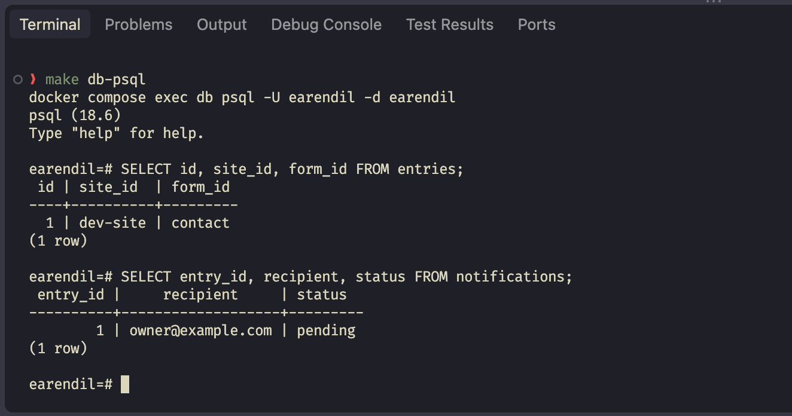

## What did I do last week?
Last week, I finished work on the "consumer" side of the Go form service which is responsible for collecting batches of submitted forms from the Cloudflare queue and handing them off to the "ingest" package which updates the database and will later also trigger a notification emails. This is a major step since the entire process can now run end to end from form submissions up to saving the form entry in the database. To assist with future development, I also added a seed script and a "devqueue" that can be used to mock form submissions pending in the Cloudflare queue without actually having to submit test forms and stay connected to Cloudflare. I'll use the devqueue from here on until the notifications side of the Go service is complete as well.

The screenshot below shows the Postgress database query showing a successful form entry saved and a pending notification ready to send to the test site's registered recipient.

## My plan for this week
This week, I plan to integrated the notifications system and test it using a tool called Mailpit. Mailpit is an email and SMTP testing tool that can run locally in a container and connect to applications for automated testing. In this case, I will be hosting a Mailpit image in a Docker container, just like the Postress image I already have setup. There will be a testing config that provides the test SMTP credentials to the Go service and then all test email notifications can be processed just like real emails. It even has an inbox UI accessible on local host. I'm curious to see how it all works and if there will be any hang ups along the way, but reading through the documentation, it looks pretty straightforward, not too different from the SMTP setup I've done for the sites we manage at work. 

## Impediments and blockers
I don't have any major impediments or blocks at the moment, but I may not have as much time as I'd like this coming week, so I'm trying to plan around that. Even if I don't get the notification system working, I think I'm doing well overall in terms of progress, so it shouldn't be a big issue.

## Reflection
This week, I really made use of Go's built in testing tools and libraries to test and setup the consumer without needing a constant queue running in Cloudflare. After confirming the shape of the data and how Cloudflare's queue API works, I didn't really need to worry about doing all this through Cloudflare so long as I had good tests setup and can correctly mock that data. It's made the overall process a lot easier and is something I will try to do more of in the future.
